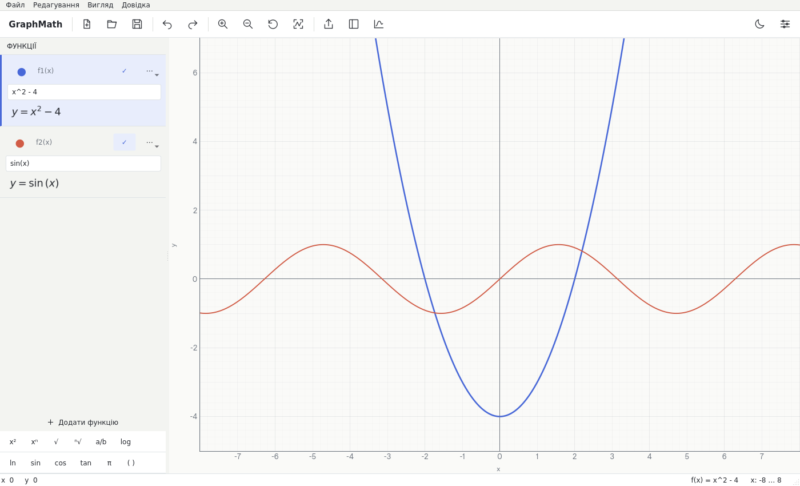

# GraphMath 1.0

An offline Windows mathematical workspace with a Ukrainian interface. The graph is
the main work surface: compact function rows, typeset formulas, independent
coefficient sliders, and an optional analysis inspector. Built as a standalone
project in the assigned **FoRe1n/MathGraph** repository; no connection to MathTrainer
or CS2 Optimizer.



## Windows download

Download **[GraphMath v1.0.0 for Windows x64 (ZIP)](https://github.com/FoRe1n/MathGraph/releases/download/v1.0.0/GraphMath-v1.0.0-Windows-x64.zip)**
([release notes and SHA256](https://github.com/FoRe1n/MathGraph/releases/tag/v1.0.0)).
Extract the **entire folder** and open `GraphMath.exe`. Windows 10/11 x64;
no Python, account or network connection required. Do not move the EXE away from
its `_internal` folder. The portable build is unsigned.

[Native Windows CI](https://github.com/FoRe1n/MathGraph/actions/runs/39971378185)
passed all 81 tests, source/frozen startup checks and resource verification before
publication. The public download was independently downloaded and its SHA256 and
ZIP integrity verified. See [validation details](docs/validation.md).

## Features

- Multiple independently colored, editable, hideable and duplicable functions
  (up to 100; 10-function workflows covered by tests).
- Restricted AST parser; explicit multiplication, real-domain evaluation, radicals,
  powers, logarithms, rational, trigonometric and absolute-value functions.
- Debounced expression editing and cached NumPy evaluation; domain/pole path breaks.
- Live MathText previews with packaged mathematical fonts.
- Per-function coefficient sliders with bounds, step and reset value.
- Pan/zoom, curve selection, cursor inspection, fit/reset, grid and axis controls.
- Process-isolated symbolic analysis with an eight-second timeout; roots, derivative,
  domain/range, monotonicity, extrema and asymptotes where reliably determined.
- Optional root/extremum/intersection/asymptote markers and approximate tangents.
- Versioned `.graphmath` JSON projects, atomic saves, recent files, unsaved-change
  prompts, undo/redo and standard shortcuts.
- Clean live-scene PNG/SVG/PDF export, transparent PNG, light/dark themes and settings.

## Development

Python 3.12 is the reproducible build target (source requires 3.11+).

```bash
python -m venv .venv
# Linux:
.venv/bin/python -m pip install --require-hashes -r requirements-linux.lock
.venv/bin/python -m graphmath
# Windows PowerShell:
.venv\Scripts\python -m pip install --require-hashes -r requirements-windows.lock
.venv\Scripts\python -m graphmath
```

Run tests with the same interpreter: `python -m pytest -q`. Headless validation:
`python -m graphmath --smoke-test --smoke-output artifacts/smoke`. This starts the
actual Qt window, round-trips a project, exports all three formats, captures both
themes, writes `result.json`, and returns a nonzero status on failure.

No service, credential or database is required. Headless Linux may need
`QT_QPA_PLATFORM=offscreen`; a real desktop needs the usual Qt/X11 system libraries.

## Structure and documentation

- `graphmath/core`: safe parsing and vectorized real numerical evaluation.
- `graphmath/plotting`: sampling and live graph export.
- `graphmath/analysis`: exact SymPy analysis, isolated from the GUI.
- `graphmath/persistence`: validated versioned JSON, atomic writes.
- `graphmath/ui`: Qt canvas, function editor, parameter controls, inspector, themes.
- `graphmath/app`: entry point and packaged smoke-test mode.
- [Ukrainian user guide](docs/user-guide.uk.md)
- [Engine API and limits](docs/engine.md)
- [Windows build and release](docs/windows-build.md)
- [Validation report](docs/validation.md)

Original code is MIT licensed. See [THIRD_PARTY_NOTICES.md](THIRD_PARTY_NOTICES.md)
for bundled libraries, font licenses, and Qt LGPL replacement rights.
