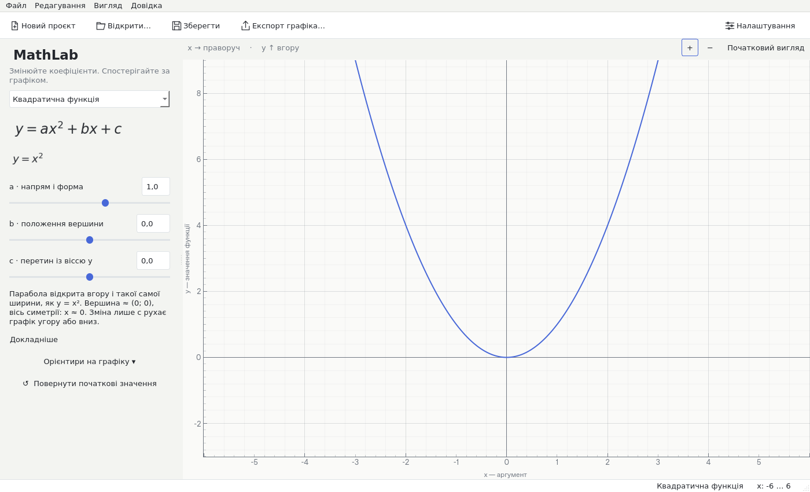

# MathLab 1.0

An offline Ukrainian mathematics laboratory for high school students, evolved
incrementally from GraphMath in the existing **FoRe1n/MathGraph** repository.
Choose a function, move its coefficients, and see both the curve and an explanation.



## Windows distribution

**[Download MathLab v1.0.0 for Windows x64 (ZIP)](https://github.com/FoRe1n/MathGraph/releases/download/mathlab-v1.0.0/MathLab-v1.0.0-Windows-x64.zip)**
([release notes and SHA256](https://github.com/FoRe1n/MathGraph/releases/tag/mathlab-v1.0.0)).
Extract the entire folder and double-click **MathLab.exe**. Python is not required.

[Native Windows release CI](https://github.com/FoRe1n/MathGraph/actions/runs/39990444777)
passed all 147 tests, offscreen benchmarks, source/frozen smoke checks and resource
verification. The public ZIP was downloaded without authentication and its SHA256,
all ZIP entries and Windows AMD64 executable header were independently verified.

The original [GraphMath v1.0.0 release](https://github.com/FoRe1n/MathGraph/releases/tag/v1.0.0)
and its tag remain available. Internal `graphmath` imports, the expression engine,
PyQtGraph, NumPy/SymPy, existing analysis and project format are retained.

## Learning workspace

- **Quadratic:** y = ax² + bx + c; correct vertex, symmetry, intercept and degenerate
  cases, with optional graph markers.
- **Exponential:** y = a·bˣ + c; positive base excluding 1, growth/decay, reflection
  and translation explained from the actual coefficient values.
- **Logarithmic:** y = a·log_b(x − h) + k; safe bases, explicit x > h domain and
  shaded excluded region, shifts and reflection.
- **Custom functions:** the existing multiple-function editor, independent
  parameters, analysis, annotations, undo/redo, colors and visibility remain.
  Safe school notation includes `x²`, `2x`, `2(x+1)` and explicit `2*x`.

The graph dominates a light workspace. Five toolbar actions, readable formulas,
short Ukrainian explanations, adjustable sliders and a compact settings dialog
replace the former editor-first default. Dark mode remains available. No account,
API key, server or Internet connection is needed for ordinary use.

## Compatibility and performance

Old `.graphmath` files retain formulas, colors, parameters, visibility and ranges.
Version 1 remains in use; optional `mode` metadata defaults to `custom` for old
files. Old GraphMath readers ignore this additive field. No project migration is
required. The original regression cases remain in the test suite, with a dedicated
legacy workspace fixture and additional learning-mode tests.

Raster profiling identified axis/grid painting as a major cost. MathLab uses a
bounded grid, cached overscan samples, reused graphics, fast active interaction and
idle refinement. JSON history and formula previews are coalesced. Cursor inspection
is optional and no longer creates repeated tooltips or large crosshairs.
See [measurements and limitations](docs/mathlab-performance.md); no 60 FPS claim is made.

## Development

Python 3.12 is the reproducible build target; internal package and CLI remain
`graphmath` for compatibility. Run from the existing checkout:

```bash
python -m venv .venv
# Linux
.venv/bin/python -m pip install --require-hashes -r requirements-linux.lock
.venv/bin/python -m graphmath
# Windows PowerShell
.venv\Scripts\python -m pip install --require-hashes -r requirements-windows.lock
.venv\Scripts\python -m graphmath
```

Tests: `python -m pytest -q`. Source/frozen smoke mode:
`python -m graphmath --smoke-test --smoke-output artifacts/smoke`.
It checks all laboratories, the preserved analysis worker, project I/O and exports.
Real Qt screenshots: `python scripts/capture_mathlab_qa.py`.
Reproducible interaction measurements: `python scripts/benchmark_interaction.py`.
Headless Linux selects `QT_QPA_PLATFORM=offscreen`; an interactive desktop needs a
display and the usual Qt system libraries. PyInstaller's `GraphMath.spec` filename
is retained; its default distribution is now `MathLab`.

- [Ukrainian user guide](docs/user-guide.uk.md)
- [Architecture and engine API](docs/engine.md)
- [MathLab validation and changed files](docs/mathlab-validation.md)
- [Performance measurements](docs/mathlab-performance.md)
- [Windows build and release](docs/windows-build.md)
- [Original GraphMath validation](docs/validation.md)

Original code is MIT licensed. [Third-party notices](THIRD_PARTY_NOTICES.md) cover
Qt/PySide6 LGPL components, mathematical fonts and other dependencies. Libraries
remain dynamically replaceable in the portable distribution. Builds are unsigned.
