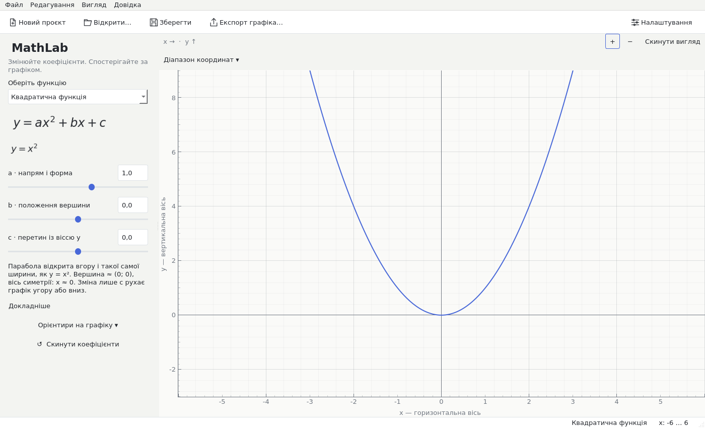
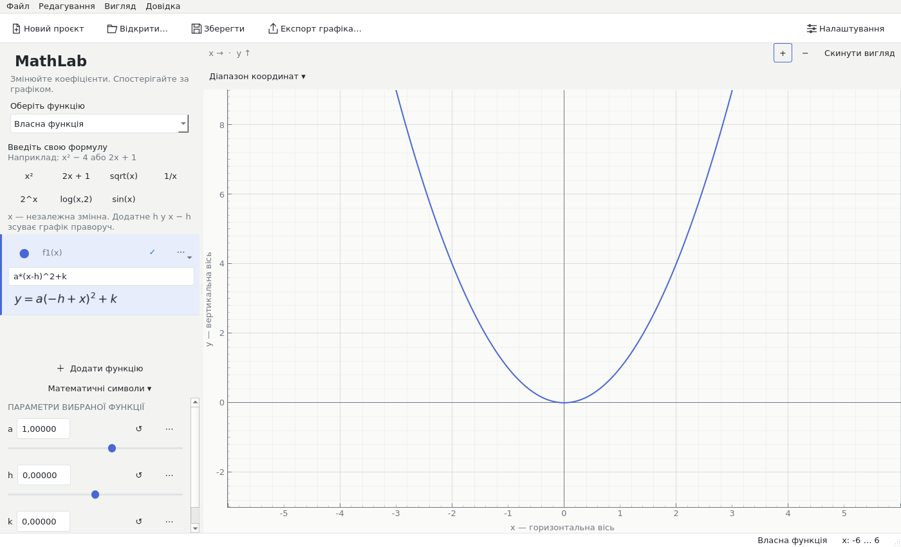
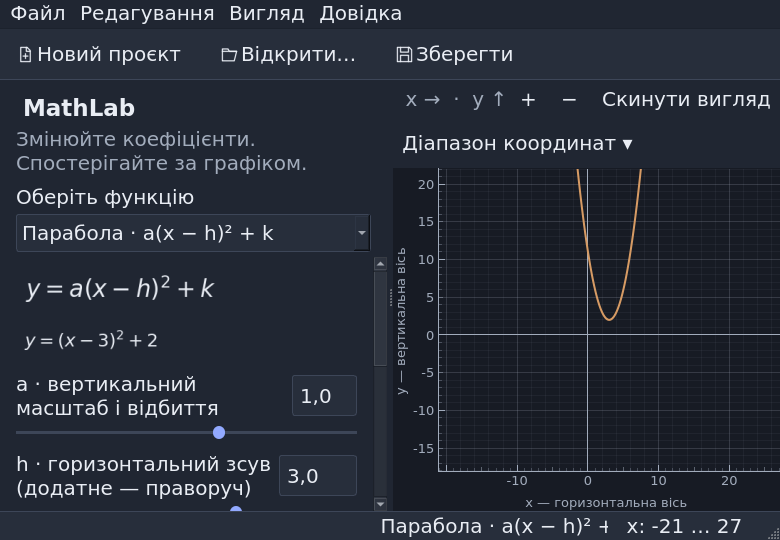
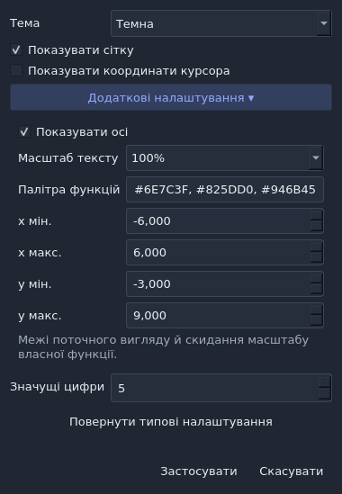

# MathLab 1.1.3 stabilization audit

Scope: fixes, performance and verification of the existing twenty templates and
custom workspace. No new mathematical categories, major interface components,
project format or dependencies were added. Development branch:
`fix/mathlab-v1.1.1-audit`.

Baseline: published MathLab v1.1.0, source `11822ffa4b39abddfd8dbe9a2a06bcd388ed982b`;
its documentation-only successor `c35d7d11948e440aee0ce5bf150506c83b30237a` was the
clean starting checkout and archived comparison source. Baseline suite:
**282 passed, zero failed** before implementation. Existing releases and branches
were preserved; no reset or force push was used.

## Windows font audit follow-up

The first published stabilization build, v1.1.1, passed 453 Windows tests and
source/frozen smoke. Its public validation screenshots then revealed a critical
coverage gap: ordinary Qt text was missing-glyph boxes while Matplotlib formulas
were readable. It was not accepted as the final validated deliverable. The
published version and assets were preserved; the correction uses v1.1.2.

The existing Matplotlib DejaVu regular/bold/italic fonts are now registered with
Qt before graphics creation. The UI chooses a verified family, and axes use the
same resolved application font. No font download or new dependency was added.
Twelve regression tests check actual glyph indexes, real styled widgets, all
faces and tick fonts. Screenshot capture fails on missing Latin/Ukrainian glyphs;
source and frozen smoke explicitly assert coverage and record the chosen font.

All 61 local captures passed after the correction, including 138 probe characters
at 13/16/20px with zero missing glyphs. Final native/public-image verification is
recorded below only after it is complete.

## Final parameter locale audit

The Windows font correction was confirmed by actual readable v1.1.2 Windows
images, but a final precision-control check found that scientific text with a dot
was invalid under Ukrainian locale. A subsequent round-trip check also exposed
possible loss of newly entered ordinary precision if it was displayed with only
five decimals. Version 1.1.3 corrects these together: locale-aware shortest
scientific text, enough internal Qt precision for validation, and full required
fractional precision for ordinary entered values. Slider ticks use decimal step
arithmetic to avoid exposing binary rounding tails. Simple values retain their
familiar compact display.

Ten additional regressions cover C/Ukrainian scientific and normal high-precision
round trips, fine slider values and preservation of the least-subnormal project
value. When Qt cannot represent such a value in its editor, the true value stays
visible, stored data remains unchanged, and editing is explicitly unavailable.
An independent review also passed 18 further round trips through 1e-300.

The intermediate published tags were preserved rather than overwritten; the
final validated deliverable is v1.1.3 after its native checks and public-asset
inspection. No function category, control feature or dependency was added.

## Defects reproduced and fixed

- Constant arithmetic could hide a zero divisor or a logarithm base of one.
  Numeric exponent arithmetic could reject negative x from an effectively
  integral power; odd rational powers incorrectly used a complex-root convention.
  Constants are checked independently and odd-denominator powers use real roots.
- Short nested constant powers could monopolize the UI thread. An AST cost check
  rejects excessive exact-number expansion before SymPy work, with normal finite
  expressions and compact pi/e constants covered by positive regressions.
- Parameter-only divisions escaped as Python errors; vertical coordinates used
  symbolic substitution and ignored original domain guards. Both now use cached,
  domain-checked numeric evaluation. Vertical relations remain distinct from y
  functions in rendering, editing and analysis.
- Sine/cosine analysis crashed on oscillating limiting ranges. A cancelled second
  formula could invent intersections outside its domain. Single-period inequality
  solutions could be presented as global monotonicity; ordinary odd-root analysis
  could expose distributional derivative artifacts. Results now retain all domain
  guards, distinguish scalar limits, and state unsupported solver limitations.
- Decimal cancellation could erase a true double root or produce spurious tiny
  roots/intercepts. A global small-number cutoff also turned valid logarithmic
  zeros into excluded boundary points. Deterministic lab reports now use exact
  decimal coefficient checks and retain genuine scientific values and offsets.
- Invalid-to-valid formula edits could leave a permanently blank curve because
  an old cache entry survived clearing its graphics data. Cache invalidation now
  restores the curve. Expanded even poles and undersampled tan/sec/csc/cot branches
  no longer get connected. ULP-based phase checks preserve valid tiny-angle values.
- Exports could capture queued/low-quality data or truncate an existing file on
  failure. Export now synchronizes the scene, excludes transient cursor graphics,
  closes PDF resources, validates a temporary output and replaces atomically.
- Corrupt preferences/recents could crash startup. Damaged project integers,
  decoder errors and invalid Unicode could leak raw failures. Saved metadata is
  validated and file errors remain understandable Ukrainian messages.
- Worker spawn and pipe failures could leave disabled controls or live resources;
  shutdown could retry a closed channel. Cleanup now reaps workers, escalates
  termination when needed and retains developer diagnostics without user tracebacks.
- Temporary invalid formulas erased parameter values, native formula undo lost
  tuned coefficients, delayed edits could synchronize the wrong graph, and fine
  slider steps rounded away. Parameter memory, per-function synchronization and
  adaptive numeric precision preserve values. Document resets clear old input undo.
- Existing-template switches rebuilt every editor row. Hidden quadratic markers
  recomputed roots during pans. Rows and unchanged controls are reused and marker
  work is cached without changing sampling, graphics reuse, grid or interaction
  throttling. Ten existing-template switches went from twenty row constructions
  to zero; pans with all markers off no longer compute their roots.
- Settings promised a viewport change but did not apply it. Edited ranges now
  apply; theme-only changes retain the viewport. Irrelevant PDF width controls are
  disabled. Narrow/scaled headers, formula previews and controls fit or remain
  reachable through scrolling. Ukrainian coefficient, reset, domain and settings
  wording was corrected, and accessibility names follow reordered rows.

## Mathematics and integration

Independent expectations cover all existing families: linear/direct/constant,
vertical relations, inverse proportionality, quadratic standard/square/vertex,
cubic, absolute value, three root orientations, original/transformed exponential
and logarithmic forms, sine/cosine/tangent and custom formulas. Tests check known
points, positive/negative/zero coefficients, domains/ranges, parity, extrema,
intercepts, asymptotes, periods and translations/reflections. Original-domain holes
remain excluded even when multiplied by zero. Numeric labels are rounded explicitly.

Source smoke passed all twenty modes, project roundtrips, the analysis subprocess,
light/dark rendering and PNG/SVG/PDF export. Legacy GraphMath v1 projects retain
format version 1. Existing custom editing, visibility/colors, history, themes,
analysis, saves and exports remain. No existing test was removed or weakened.

**Final Linux suite: 475 passed, zero failed, zero errors, zero skipped.**
The final source smoke result reports version 1.1.3 and all twenty laboratory
modes. Both commands executed and completed successfully. The final Windows
release evidence is recorded below once its tagged checks finish.

## Real visual review

The Qt capture runner produced **61 actual screenshots**, with callback exceptions
configured to fail the run. It covers all templates in light/dark, custom input and
errors, transformed/zoomed plots, manual ranges, settings/export dialogs, and narrow
100/125/150% text scaling. Review caught and corrected header clipping, a cramped
custom formula and a truncated settings hint. Representative final captures:

These are real offscreen Qt windows, not generated mockups. Physical Windows 11
input, compositor behavior and monitor DPI still require manual testing.

## Core stabilization comparison (v1.1.0 to v1.1.1)

Same Linux x64/Python 3.12.14/hash-locked dependencies and unchanged benchmark driver
for each version. Archived v1.1.0 and the patch ran serially with no test suite,
screenshot capture or agent diagnostics competing with the measurements. Original
interaction workloads used 60 actions per scenario and 5,000 prolonged steps.

| Median milliseconds | v1.1.0 | v1.1.1 |
| --- | ---: | ---: |
| Quadratic pan + forced raster | 9.004 | 8.162 |
| Five functions pan + raster | 13.987 | 14.484 |
| Five functions wheel + raster | 14.152 | 14.023 |
| Five functions idle raster | 16.260 | 15.900 |
| Learning slider + raster | 3.185 | 3.230 |

The additional driver covers all other requested interactions with actual Qt
callbacks/events. Every drag gesture delivers a press, three moves and release
and asserts that the viewport moves. After the first before/after run, variability
prompted alternating repeats (patch, baseline, patch, baseline), thirty actions
per scenario. Below are the medians of the three run medians, not selected best
runs. These are interaction latencies and **not desktop FPS**.

| Median of run medians, ms | v1.1.0 | v1.1.1 |
| --- | ---: | ---: |
| Existing-template switch | 96.945 | 29.928 |
| Custom formula update | 11.632 | 10.512 |
| Editor/analysis panel toggle | 16.859 | 13.531 |
| Actual Qt mouse gesture + raster | 19.472 | 17.043 |
| Theme change | 77.300 | 73.167 |
| Repeated zoom in/out | 11.210 | 9.970 |
| Resize while plotting | 21.753 | 17.789 |

Tail measurements are retained. The first patch extended run was noisier: its
worst theme action was 253.333 ms, formula edit 159.911 ms, and drag gesture 65.681 ms.
Repeat runs reduced typical timings but do not erase these observations. There
is no guaranteed latency bound or hardware 60 FPS claim. The sustained hot pan path
retained zero new sampling calls in all scenarios. Five-function pan p95 was
19.842 ms before and 18.228 ms after.

Both 5,000-step runs retained one curve and one sample-cache entry. RSS growth
was 0 bytes before and 4,096 bytes after.
This is bounded state in this workload, not a claim about leak-free operation over
hours or on all hardware. The nested-constant reproduction was separately limited
to two CPU seconds and 128 MB additional virtual memory: baseline was killed after
parsing; the patch returned a friendly error in about 1 ms.

Raw records (including p95/max, RSS and widget/scene/cache counts):

- [baseline-interaction](performance/mathlab-v1.1.1-baseline-interaction.json)
- [baseline-stabilization](performance/mathlab-v1.1.1-baseline-stabilization.json)
- [final-interaction](performance/mathlab-v1.1.1-final-interaction.json)
- [final-stabilization](performance/mathlab-v1.1.1-final-stabilization.json)
- [baseline-extended-repeat-a](performance/mathlab-v1.1.1-baseline-extended-repeat-a.json)
- [baseline-extended-repeat-b](performance/mathlab-v1.1.1-baseline-extended-repeat-b.json)
- [final-extended-repeat-a](performance/mathlab-v1.1.1-final-extended-repeat-a.json)
- [final-extended-repeat-b](performance/mathlab-v1.1.1-final-extended-repeat-b.json)
- [Bounded constant-resource reproduction](performance/mathlab-v1.1.1-constant-resource.json)

## Reproduction and remaining limits

Run from the existing checkout with `.venv/bin/python -m pytest -q`,
`.venv/bin/python -m graphmath --smoke-test`,
`python scripts/benchmark_interaction.py --frames 60 --session-steps 5000`,
`python scripts/benchmark_stabilization.py --frames 30`, and
`python scripts/capture_stabilization_qa.py`. Use the venv Python and
`QT_QPA_PLATFORM=offscreen` where there is no desktop display. Both benchmark
scripts accept `MATHLAB_BENCH_SOURCE` for archived-source comparisons.

Finite sampling cannot prove continuity or detect every arbitrary nonlinear
feature between samples. Unsupported symbolic global periodic inequalities and
ordinary odd-root derivatives report a limitation. Floating-point and Qt decimal
precision limit extreme subnormal parameter editing; ordinary fine steps down to
1e-8 were explicitly regression tested. Hardware Windows 11, monitor DPI,
compositor FPS and code signing are not established by offscreen CI. Builds remain
unsigned. No known critical defect remains in the exercised school workflow.

## Final v1.1.3 performance recheck

After the 475-test suite and source smoke, the final source ran the same serial
interaction benchmark (60 actions and 5,000 prolonged steps) and extended benchmark
(30 actions). No screenshot or test workload ran concurrently. These are Qt
interaction and forced-raster latencies, not physical Windows 11 frame rates.

| Median milliseconds | v1.1.0 baseline | final v1.1.3 |
| --- | ---: | ---: |
| Five functions pan + raster | 13.987 | 14.678 |
| Five functions wheel + raster | 14.152 | 14.270 |
| Learning slider + raster | 3.185 | 2.870 |
| Existing-template switch | 107.871 | 30.968 |
| Mouse press/three moves/release | 21.407 | 18.645 |
| Custom edit | 11.632 | 13.509 |
| Theme change | 82.198 | 79.577 |
| Repeated zoom | 17.544 | 10.634 |
| Resize | 21.753 | 19.753 |

Five-function pan p95 was 19.842 ms before and 23.401 ms after; the median stayed comparable, while this run's tail was slower. The final 5,000-step run retained one curve/cache entry with 0 bytes RSS growth. Other latency spikes and prior repeats are retained above rather than discarded.

Raw final records: [interaction](performance/mathlab-v1.1.3-interaction.json) and
[extended workloads](performance/mathlab-v1.1.3-stabilization.json).

## Windows release validation

The font-fixed [Windows pilot](https://github.com/FoRe1n/MathGraph/actions/runs/40198991232)
passed packaged glyph checks; its public images were independently downloaded
and visually inspected as readable. The final tagged v1.1.3 run must additionally
pass all 475 tests, locale cases, source/frozen glyph smoke and all screenshots.
Its frozen EXE runs outside the source checkout with Python removed from PATH and
PYTHONPATH/PYTHONHOME cleared, verifying the bundled runtime and resources.
Final tagged/public-asset evidence is recorded here only after checks succeed.
Windows 11 hardware/monitor/compositor testing remains a manual task.
