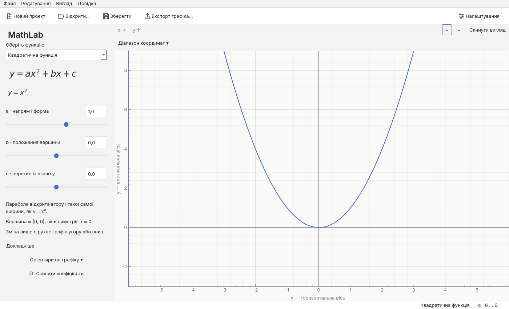
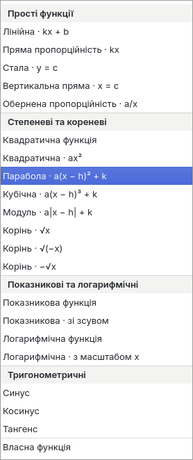
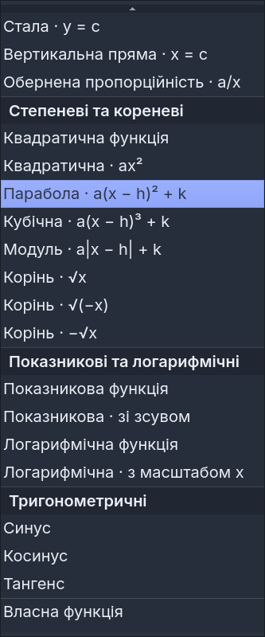
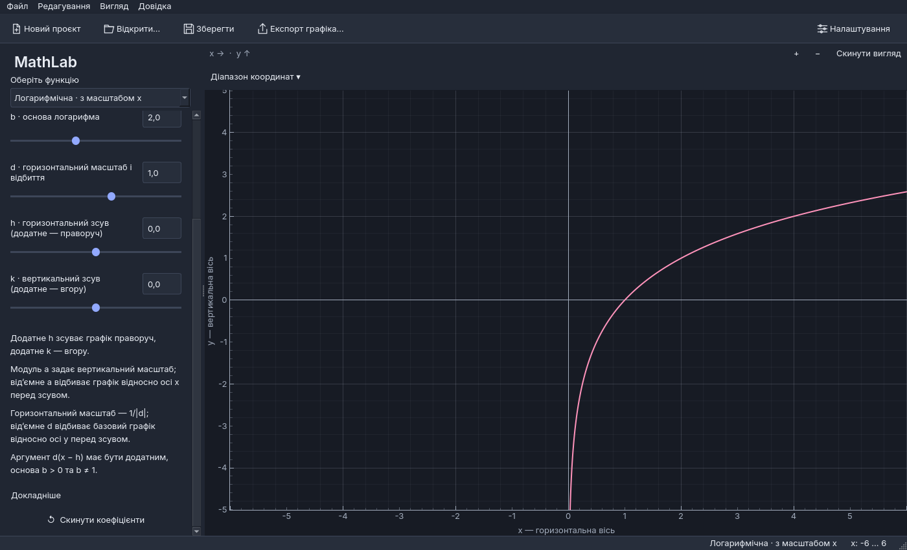
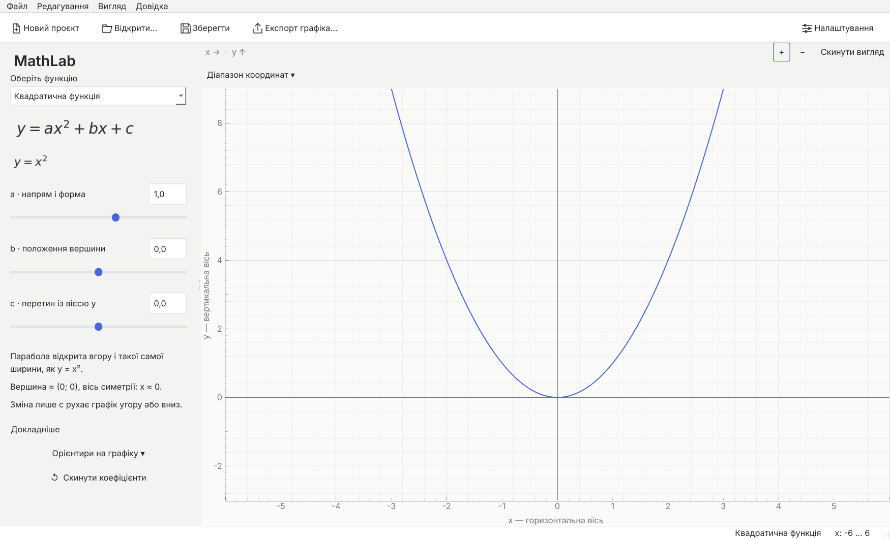
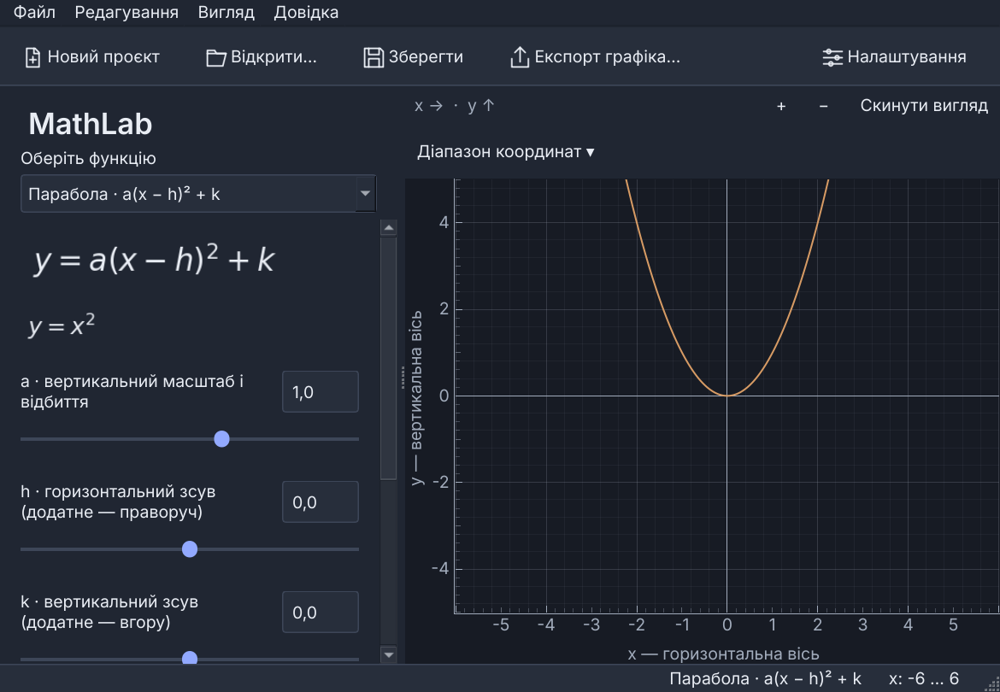
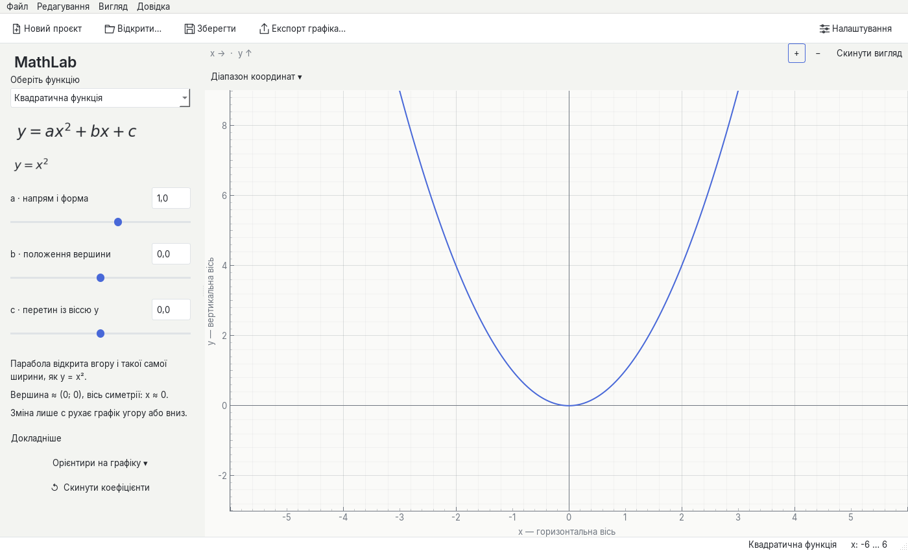
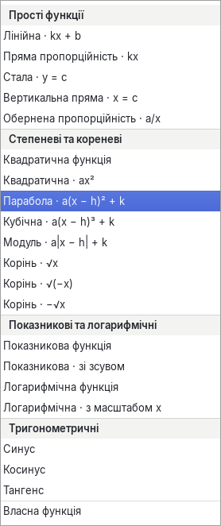
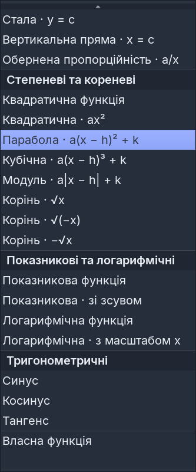
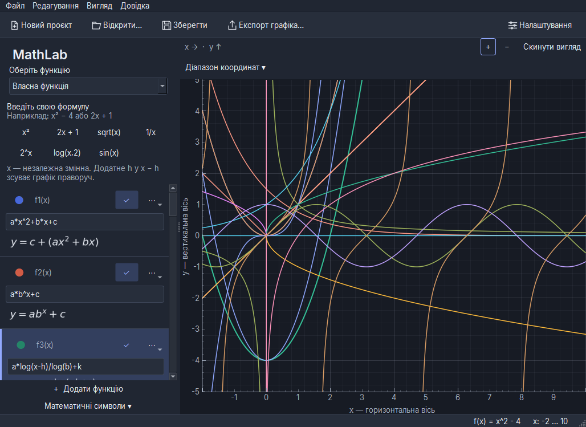

# MathLab 1.1.5 — typography and single-file packaging validation

Date: 2026-10-29. This is a focused polish patch over published v1.1.4.
Work is isolated on `fix/mathlab-v1.1.5-polish`; previous branches, tags and
releases are preserved. No mathematical category or product feature was added.

## Typography and readability

The UI now uses **Inter 4.1**, with unmodified static Regular, Medium and SemiBold
faces from the official Inter release. Their total size is 1,248,684 bytes.
The SIL Open Font License and copyright are bundled, together with upstream and
individual file hashes in [font provenance](../graphmath/resources/fonts/README.md).
No proprietary font or new Python dependency was introduced.

Inter supplies the Ukrainian alphabet and actual 400/500/600 weights. Bundled
DejaVu supplies mathematical/decorative symbols unavailable in Inter and remains
a verified fallback when Inter cannot load. Formula previews retain their existing
dedicated mathematical font. Glyph validation checks actual Qt shaping runs;
testing only the primary font would incorrectly reject supported fallback symbols.
A deliberately unsupported Unicode character still fails validation.

The existing logical font sizes and Qt 6 DPI handling are retained. There are no
CSS transforms, bitmap scaling tricks or forced device-scale overrides in normal
application startup. Fresh QA processes use Qt device-pixel ratios 1.0/1.25/1.5;
these are separate from the application's existing text-size setting.

Coefficient labels wrap with their genuine height-for-width policy. Values remain
aligned beside labels, with a separate slider underneath and more space between
coefficients. Qt's standard scroll-layout constraint propagates content minima;
no fixed field heights, resize hooks or custom layout timers were introduced.
The explanation uses escaped, unchanged mathematical sentences, short paragraphs,
125% real Qt paragraph leading and additional margins. The old QLabel CSS
`line-height` had no effect. All twenty templates and zero-multiplier explanations
are checked against the original plain text.

The standard function combo remains. Group headings are nonselectable, semibold
and separated by subtle lines/backgrounds. The custom option has a separator.
Ordinary items retain native Qt selection and keyboard navigation; tests traverse
every function in both directions. Selected text in the dark theme now contrasts
with its existing highlight. The exact instruction **“Змінюйте коефіцієнти.
Спостерігайте за графіком.”** was removed without a replacement spacer.

## Preserved behavior and QA

The expression engine, symbolic analysis, sampling, graph rendering mechanisms,
grid, custom editor logic, parameter ranges/steps/precision, project format and
save/export implementations have no changes in this patch. Existing `.graphmath`
compatibility, graph colors, interaction caches and all twenty templates remain.

The first complete local pass after the UI changes passed **503 tests**. Subsequent
QA additions cover Windows environment handling, cross-platform diagnostics and
public CI failure reporting. The final Linux suite passed **511 tests, zero
failures, errors or skips**. The native Windows pilot also passed its complete
suite; published JUnit results are independently checked below after release.
An older cache test was also made deterministic: it keeps the exact
zero-hot-sampling and serialization assertions, then requires the real idle timer
to finish with one or two samples. Its previous 90 ms snapshot could cross the
production 140 ms idle deadline during a slow Qt paint. The production timer
and the separate production-timing test remain unchanged.

Source smoke passed all twenty modes, actual coefficient spinboxes/sliders,
project save/load, analysis subprocess, fonts/resources and PNG/SVG/PDF export.
The capture runner passed **101 actual Qt captures**: 75 normal captures including
dropdowns/text scales, plus 13 at each of 125% and 150% device scale. Every capture
checks actual control glyphs. Visual inspection covers both themes, coefficient
panels, long explanations, dropdowns, custom editing, settings and narrow windows.
The three reference screenshots mentioned in the request were not attached;
review used the existing application and actual new captures.

## Comparable local performance

Archived v1.1.4 source `a025e3e` and the patch use identical benchmark drivers,
Linux/Python 3.12.14 and unchanged locked dependencies. Measurements ran serially
without competing tests/captures. The machine is shared; repeat variability is
retained. These are Qt event/forced-raster latencies, **not physical desktop FPS**.

| 60-action workload, median / p95 ms | v1.1.4 | v1.1.5 |
| --- | ---: | ---: |
| Five-function pan | 33.952 / 235.631 | 27.403 / 54.487 |
| Learning slider | 5.445 / 23.132 | 4.998 / 8.811 |
| Repeated pan batch | 27.498 / 74.491 | 23.109 / 31.696 |
| Repeated slider batch | 5.690 / 20.153 | 5.206 / 10.458 |

The final 5,000-step session retained one curve and one sample-cache entry;
RSS grew 24,576 bytes. This is a bounded workload result, not a universal leak
guarantee. Five-function pan maxima were 331.983 ms before and 57.217 ms after in
the initial batch; the baseline repeat reached 365.567 ms. No renderer change or
frame-rate claim is justified by these data.

Three alternating 30-action extended runs show more variability. Below are the
medians of the three run medians, including the slower runs rather than choosing
the best result:

| Extended workload, median of run medians, ms | v1.1.4 | v1.1.5 |
| --- | ---: | ---: |
| Existing-template switch | 43.943 | 59.180 |
| Custom formula update | 16.686 | 22.365 |
| Editor/analysis panels | 25.299 | 25.717 |
| Actual Qt drag gesture | 28.082 | 37.682 |
| Theme change | 161.349 | 163.047 |
| Repeated zoom | 14.589 | 15.623 |
| Resize | 28.182 | 29.875 |

Some UI workloads are slower in these samples; there is no blanket improvement
claim. Identical baseline theme medians ranged 103.989–178.696 ms, while patch
medians ranged 154.072–338.072 ms. The typography update adds text shaping,
paragraph reflow and wrapped-content size propagation; shared-host variability
also prevents assigning every difference to one cause. Diagnostic plain-text and
DejaVu substitutions did not establish a stable general bottleneck and were not
shipped. The graph hot path and numerical algorithms were preserved.

A same-window, alternating 200-action slider diagnostic isolates paragraph
presentation: rich/plain medians were 6.513/5.440 ms, then 6.756/6.092 ms.
The observed **0.664–1.073 ms** presentation cost is documented for the requested
readable paragraph layout. These diagnostic variants change no repository source
and are not alternate application modes. Native same-runner comparisons are
recorded after public release evidence is verified.

All raw median/p95/maximum/RSS records are in `docs/performance/` with the
`mathlab-v1.1.5-` prefix, including original runs, repeats and diagnostic records.

## Single-file Windows validation

The existing one-folder recipe is retained. `GRAPHMATH_ONEFILE=1` selects the
standard PyInstaller EXE containing binaries/data, built into separate output and
work directories. The embedded archive is inspected for AMD64, every compressed
member, required dependency modules, Python/Qt, platform plugins, Inter/MathText
fonts, Ukrainian translations, icon and full licence notices. Resources use the
existing module-relative resolution in development and frozen execution.

The [successful Windows pilot](https://github.com/FoRe1n/MathGraph/actions/runs/40895385585)
built both formats and passed all packaged checks. Each format launches once with
the `offscreen` plugin and once through the real `windows` platform plugin, outside
the checkout and with only Windows directories on PATH. PYTHONPATH/PYTHONHOME are
removed. Checks exercise startup, all twenty modes, actual coefficients, plotting,
the analysis worker, save/load and PNG/SVG/PDF export. One-file extraction must be
removed after exit. Saved projects and isolated INI settings must survive outside
the bundle. The native default QSettings registry path is checked separately;
the smoke does not overwrite a user's registry preferences.

The pilot caught Windows-specific casing in copied environment dictionaries and
CRLF handling in diagnostic output. Both were corrected with cross-platform
regressions. Failing tests/packaged checks now expose bounded, escaped public
Actions annotations and retain full diagnostic artifacts; errors are not ignored.

Readiness timings measure process launch to a prepared window, including imports
and extraction plus up to 25 ms polling granularity. They are not hardware first-
frame timings or controlled cold/warm measurements. Compare formats within the
same Qt backend. One-file extraction on every launch can increase startup time.

## Verified published release

The [tagged Windows run](https://github.com/FoRe1n/MathGraph/actions/runs/40896864509)
completed successfully and published [MathLab v1.1.5](https://github.com/FoRe1n/MathGraph/releases/tag/mathlab-v1.1.5),
from source `3c27c2a014a6f43cc9b3326069a3ecad39dc01dd`.
Every build/release step reports success. The public application assets,
checksums and validation ZIP were then downloaded independently.

- [Single-file Windows x64 EXE](https://github.com/FoRe1n/MathGraph/releases/download/mathlab-v1.1.5/MathLab-v1.1.5-Windows-x64-OneFile.exe):
  **92,946,235 bytes** (92.95 MB / 88.64 MiB). Run it directly; no support folder
  or external Python is required. All 1,492 embedded archive entries, dependency
  modules and required resources were inspected. Inter font bytes match the
  committed upstream files exactly. The PE header is AMD64 and has actual Windows
  icon/group-icon resources.
- [Portable Windows x64 ZIP](https://github.com/FoRe1n/MathGraph/releases/download/mathlab-v1.1.5/MathLab-v1.1.5-Windows-x64.zip):
  **95,289,158 bytes** (95.29 MB). Extract the entire folder and run `MathLab.exe`.
  All **1,574 entries** passed CRC/safe-path checks; the AMD64 executable, embedded
  Windows icon, runtime, fonts, translations, licences and guide are present.
- [Checksums](https://github.com/FoRe1n/MathGraph/releases/download/mathlab-v1.1.5/SHA256SUMS.txt)
  match both downloaded binaries. EXE SHA256:
  `dea683235a83378b9ef0ffad8fd24ebeaa4064dc6a39f008840ff00cf5c18298`.
  ZIP SHA256: `e5fb0daaf7782d167a5c94577d1eafcc51714059502dd0b6ba165bd3b88ef9ea`.
- [Validation ZIP](https://github.com/FoRe1n/MathGraph/releases/download/mathlab-v1.1.5/MathLab-v1.1.5-validation.zip)
  passed independent CRC/path checks. Its JUnit XML reports **511 Windows tests,
  zero failures, errors or skips**, matching the final Linux full-suite result.
  All 101 captures passed, at recorded DPR 1.0/1.25/1.5, with actual control-glyph
  checks and zero missing probe glyphs. Every source/frozen smoke result passed.

The downloaded native PNGs were visually inspected, including the one-file EXE
running through the real Windows platform plugin. Ukrainian text, fallback
symbols, coefficient controls, selector selection and explanation paragraphs are
readable. The native packaged smoke uses an artificially populated twenty-template
project; its many visible curves are test data, not a default workspace redesign.

### Native startup measurements

Windows Server 2022 x64, Python 3.12.10 build toolchain. Every cell is an actual
process launch, outside the checkout and without Python on PATH. Timings include
extraction/imports and end at the prepared-window readiness marker.

| Qt platform | Portable folder, ms | Single-file EXE, ms |
| --- | ---: | ---: |
| offscreen | 1,823.821 | 5,085.359 |
| windows (normal Windows plugin) | 3,355.382 | 4,856.547 |

The normal Windows-plugin difference was **1,501.165 ms**; extraction is a real
one-file startup tradeoff. These are individual CI observations with uncontrolled
OS/antivirus caches, not guaranteed consumer startup times or cold/warm pairs.
Both one-file temporary extraction directories were removed after exit. Saved
projects/isolated INI settings survived outside them; default native registry
storage was checked separately.

### Same-runner Windows performance comparison

The published v1.1.4 source and final source ran serially on this same Windows
runner with identical drivers: 30 actions/400 prolonged steps for the basic
driver and 20 actions per extended scenario. Offscreen measurements are separate
from the native `windows` plugin startup checks and are **not hardware FPS**.

| Median / p95 milliseconds | v1.1.4 | v1.1.5 |
| --- | ---: | ---: |
| Five-function pan | 21.213 / 21.549 | 21.431 / 22.137 |
| Learning slider | 3.954 / 6.435 | 4.191 / 8.042 |
| Existing-template switch | 35.299 / 51.093 | 39.619 / 61.456 |
| Custom formula update | 10.508 / 27.234 | 10.762 / 27.340 |
| Editor/analysis panels | 14.347 / 18.572 | 15.017 / 20.024 |
| Actual Qt drag gesture | 19.296 / 21.992 | 20.161 / 21.739 |
| Theme change | 79.505 / 92.536 | 112.427 / 121.821 |
| Repeated zoom | 11.695 / 12.736 | 11.804 / 12.437 |
| Resize | 17.481 / 19.652 | 18.253 / 20.232 |

Pan/slider median differences were 0.218/0.237 ms in these samples. The larger
**32.922 ms theme-change cost** and 4.320 ms template-change cost are retained and
associated with the requested typography/wrapped-paragraph layout update; the
diagnostics above do not isolate every component's contribution. No numerical
or rendering optimization was removed to obtain this presentation. Theme changes
reapply global text styling and layout; they are not continuous drag frames.
This is a documented UI cost, not a claim of zero degradation in every workload.
The final Windows 400-step run retained one curve/cache entry, grew RSS by 57,344
bytes and reported no callback errors.

Raw public evidence and native screenshots:

- [Verification summary](performance/mathlab-v1.1.5-public-verification.json)
- [Native baseline interactions](performance/mathlab-v1.1.5-windows-baseline-interaction.json)
- [Native final interactions](performance/mathlab-v1.1.5-windows-interaction-benchmark.json)
- [Native baseline extended workloads](performance/mathlab-v1.1.5-windows-baseline-stabilization.json)
- [Native final extended workloads](performance/mathlab-v1.1.5-windows-stabilization-benchmark.json)

Builds remain unsigned. Antivirus reputation, physical Windows 11 monitor,
ClearType/DPI/compositor behavior and hardware FPS are not established by these
checks. Anonymous GitHub access exposed step conclusions, public annotations and
published evidence, but not complete raw runner logs. No physical Windows 11 or
60 FPS claim is made. No critical packaging failure remains in the verified runs.
